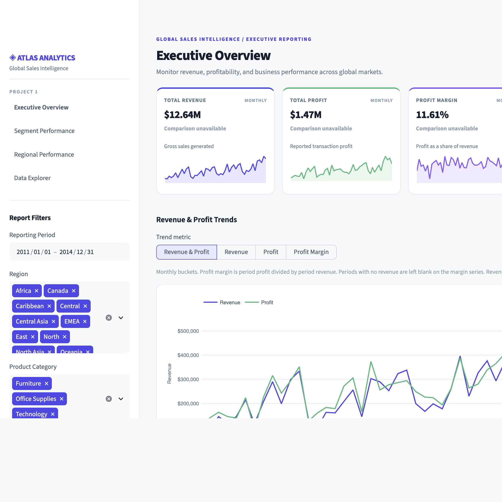
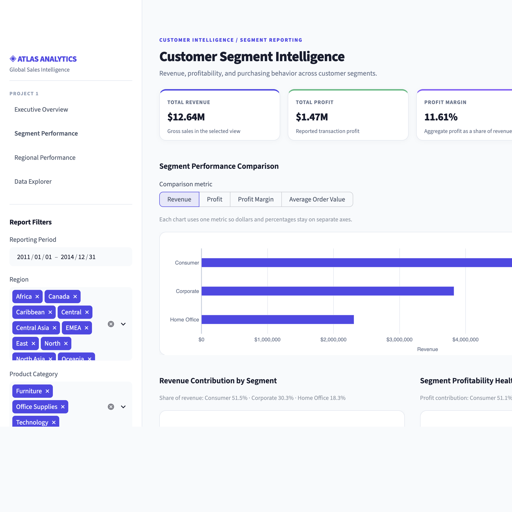
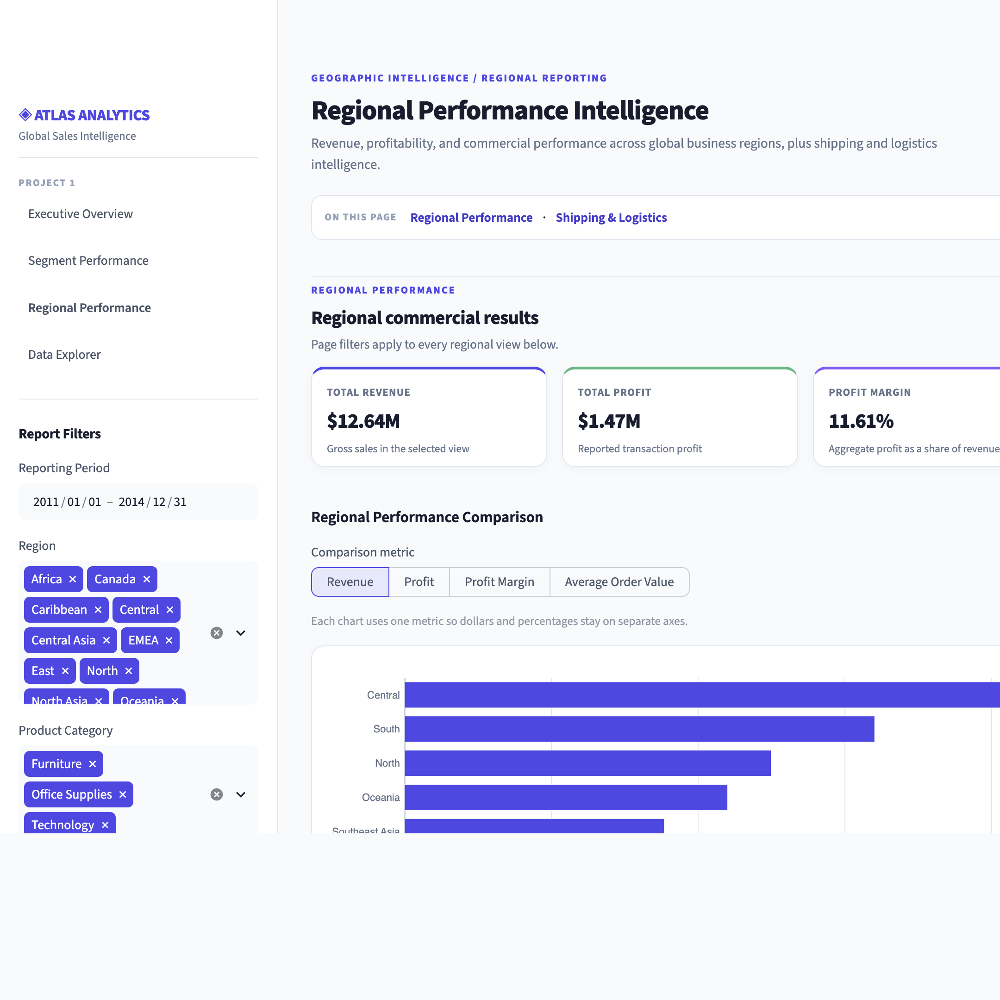
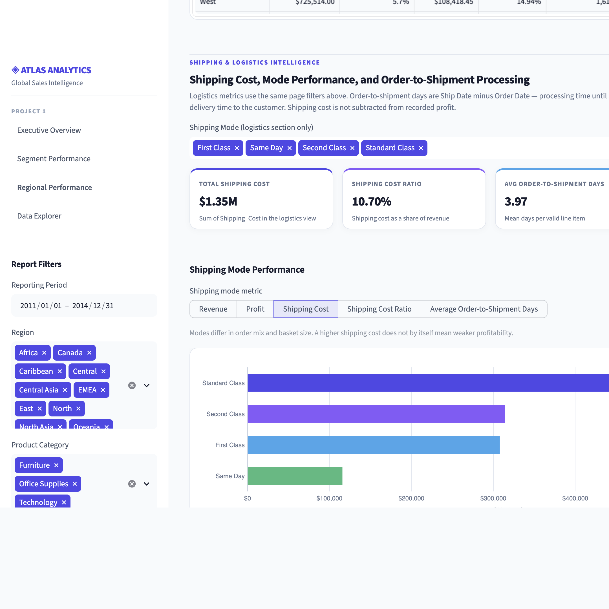
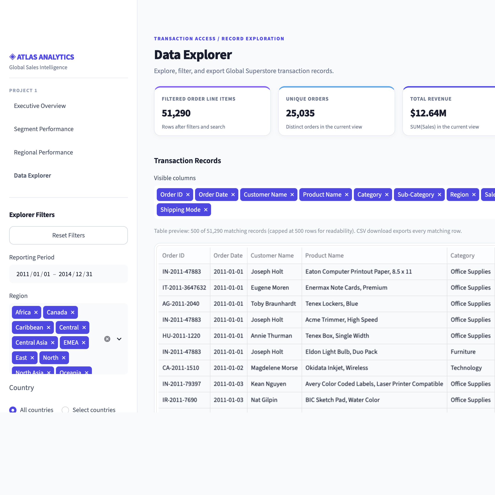

# Data Analyst Portfolio

Three Streamlit projects for analytical storytelling, diagnostic reasoning, and data preparation. **ATLAS ANALYTICS** is the primary featured project and the most complete build in this repository.

| Project | Entry point | Status |
|---------|-------------|--------|
| **1. ATLAS ANALYTICS** — Executive Sales Intelligence Dashboard | `app_kpi_dashboard.py` | Validated (Phases 1–8); **140 automated tests passing** |
| **2. Metric Drop Root Cause Analyzer** | `app_root_cause.py` | Portfolio demo / scenario tool |
| **3. Automated Data Cleaning Engine** | `app_data_cleaner.py` | Portfolio demo / upload-based tool |

Projects 2 and 3 are earlier portfolio demonstrations. They are not covered by the ATLAS test suite and should not be treated as fully validated production applications.

---

# Project 1 — ATLAS ANALYTICS

**Executive Sales Intelligence Dashboard** built with Python, Pandas, Streamlit, and Plotly on the Global Superstore dataset.

## Project Overview

Organizations need a single place to monitor sales performance, understand profitability, compare customer segments, evaluate regional results, and investigate shipping cost pressure. Spreadsheet exports and one-off SQL pulls rarely provide that view with consistent definitions, filters that stay in sync, and charts that answer follow-up questions.

ATLAS ANALYTICS addresses those needs with a multi-page Streamlit dashboard that:

- Surfaces executive KPIs with period-over-period context and sparklines
- Breaks performance down by customer segment and region with shared filter semantics
- Isolates shipping-mode cost and processing-time patterns without distorting sales KPIs
- Lets analysts explore and export filtered order-line detail for further work

The goal is decision-support clarity: consistent metrics, transparent methodology, and interactive exploration—not automated forecasting or causal claims.

## Key Features

### 1. Executive Overview (`app_kpi_dashboard.py`)

- Revenue, Profit, Profit Margin, Unique Orders, and Average Order Value
- Year / Month filters with comparison-period context and KPI sparklines
- Revenue and profit trend charts for the selected window

### 2. Customer Segment Intelligence (`pages/1_Segment_Performance.py`)

- Segment-level revenue, profit, margin, orders, and AOV
- Contribution and ranking views across Consumer, Corporate, and Home Office
- Discount intensity analysis alongside profitability (associative, not causal)

### 3. Regional Performance Intelligence (`pages/2_Regional_Logistics.py`)

- Market / region aggregations with shared Year / Month / Segment filters
- Cross-region comparison of revenue, profit, margin, and order volume
- Dynamic insight callouts derived from the filtered frame

### 4. Shipping & Logistics Intelligence (same page, dedicated section)

- Ship Mode filter **isolated** from sales KPIs (does not rescale Revenue / Profit cards)
- Shipping Cost, Shipping Cost Ratio, and Order-to-Shipment Days
- Cost and processing-time views by ship mode

### 5. Interactive Data Explorer (`pages/3_Data_Explorer.py`)

- Multi-dimensional filters (including Country All vs Select to avoid large chip sprawl)
- Preview of filtered order line items
- CSV download of the current filtered result set

## Dataset

| Attribute | Value |
|-----------|-------|
| Source | Global Superstore (`data/Global_Superstore.xlsx`) |
| Grain | **Order line item** (one row ≠ one order) |
| Line items | 51,290 |
| Unique orders | 25,035 (`Order_ID.nunique()`) |
| Period | 2011–2014 |

Each row is a product line within an order. Revenue and profit sum across lines; unique-order and AOV metrics use distinct `Order_ID` counts so line-item volume is never mistaken for order volume.

## Business Metrics

| Metric | Definition |
|--------|------------|
| **Revenue** | `SUM(Sales)` over the filtered line items |
| **Profit** | `SUM(Profit)` as provided in the dataset (shipping cost is **not** subtracted again) |
| **Profit Margin** | `SUM(Profit) / SUM(Sales)` (weighted; not an average of row-level margins) |
| **Unique Orders** | `Order_ID.nunique()` |
| **Average Order Value (AOV)** | `SUM(Sales) / Order_ID.nunique()` |
| **Shipping Cost** | `SUM(Shipping_Cost)` |
| **Shipping Cost Ratio** | `SUM(Shipping_Cost) / SUM(Sales)` |
| **Order-to-Shipment Days** | Mean of `(Ship_Date − Order_Date)` in days — **order processing / time-to-ship**, not door-to-door delivery time |

## Analytical Methodology

- **Pandas aggregations** drive all KPI and chart series; UI layers do not invent alternate totals.
- **Date-based filtering** uses order dates (Year / Month) consistently across executive, segment, and regional views.
- **Distinct-order counting** prevents double-counting multi-line orders.
- **Weighted margins** use portfolio totals (`SUM(Profit)/SUM(Sales)`), not unweighted averages of percentages.
- **Segment and regional comparisons** share the same filter frame so rankings stay comparable.
- **Discount analysis** describes co-occurrence with margin outcomes; it does **not** establish that discount caused the margin change.
- **Shipping analysis** uses an isolated Ship Mode control so logistics exploration does not silently change sales KPI cards.
- **Dynamic insights** summarize the current filtered slice; they are descriptive helpers, not statistical tests.

Observed relationships in the dashboard are associations in historical Superstore data. They do not establish causation.

## Technology Stack

| Layer | Tools |
|-------|--------|
| Language | Python 3 |
| Data | Pandas, NumPy, openpyxl |
| App | Streamlit (multipage) |
| Charts | Plotly |
| Tests | Python `unittest` |
| Config | `.streamlit/config.toml` |

## Dashboard Screenshots

Captured from the live local Streamlit app (`streamlit run app_kpi_dashboard.py`). Assets: [`docs/screenshots/`](docs/screenshots/).

### Executive Overview



### Customer Segment Intelligence



### Regional Performance



### Shipping & Logistics



### Interactive Data Explorer



## Local Setup

From the repository root:

```bash
git clone <repository-url>
cd data-analyst-portfolio

python3 -m venv .venv
source .venv/bin/activate   # Windows: .venv\Scripts\activate

pip install -r requirements.txt

streamlit run app_kpi_dashboard.py
```

Open the URL Streamlit prints (typically `http://localhost:8501`).

**Other portfolio apps (optional):**

```bash
streamlit run app_root_cause.py
streamlit run app_data_cleaner.py
```

## Testing

ATLAS includes unit and UI regression tests covering:

- KPI reconciliation against independent Pandas totals
- Filter validation (Year / Month / Segment semantics)
- Regional aggregation checks
- Logistics calculations and Ship Mode isolation
- Data Explorer CSV / filter validation
- UI regression checks (theme, layout helpers, AppTest smoke paths)

**Verified baseline:** 140 automated tests passing (Phase 8 QA).

Run Project 1 tests from the repository root:

```bash
python3 -m unittest discover -s tests -p 'test_*.py' -v
```

(`test_loader.py` at the repo root is a separate loader smoke script, not part of the `tests/` discovery set above.)

## Repository Structure

```text
.
├── app_kpi_dashboard.py      # Project 1 — Executive Overview (Streamlit entry)
├── app_root_cause.py         # Project 2 — Metric Drop Root Cause Analyzer
├── app_data_cleaner.py       # Project 3 — Automated Data Cleaning Engine
├── pages/                    # Project 1 multipage modules
│   ├── 1_Segment_Performance.py
│   ├── 2_Regional_Logistics.py
│   └── 3_Data_Explorer.py
├── utils/                    # Shared loaders, KPIs, analytics, theme
├── tests/                    # Project 1 unittest suite
├── data/
│   └── Global_Superstore.xlsx
├── docs/
│   └── screenshots/          # Dashboard PNG captures
├── .streamlit/
│   └── config.toml           # Theme / client settings (no secrets)
├── requirements.txt
└── README.md
```

## Deployment Notes (Streamlit Community Cloud)

Prepared for deployment; **not deployed in this documentation phase**.

- **Entry point:** `app_kpi_dashboard.py`
- **Data path:** relative `data/Global_Superstore.xlsx` (no machine-specific paths)
- **Dependencies:** pinned ranges in `requirements.txt` (`streamlit`, `pandas`, `numpy`, `plotly`, `openpyxl`)
- **Secrets:** none required; do not commit `.streamlit/secrets.toml`
- **Config:** `.streamlit/config.toml` for light theme and minimal toolbar

---

# Project 2 — Metric Drop Root Cause Analyzer

**Entry point:** `app_root_cause.py`

Scenario-based diagnostic demo: investigate a sudden drop in weekly checkout conversion using synthetic incident data broken down by device, OS, and traffic source. Useful for illustrating isolation-style root-cause thinking.

**Status:** Portfolio demonstration. Not part of the ATLAS validation suite.

---

# Project 3 — Automated Data Cleaning Engine

**Entry point:** `app_data_cleaner.py`

Upload a CSV, profile missing values and duplicates, apply simple cleaning controls, and download a cleaned file. Useful for illustrating basic data-health workflows.

**Status:** Portfolio demonstration. Not part of the ATLAS validation suite.

---

## License / Data Attribution

Global Superstore is a commonly used public sample dataset for retail analytics education and portfolio work. Use and redistribute according to the terms of your data source.
